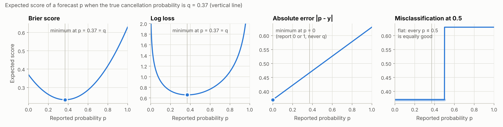
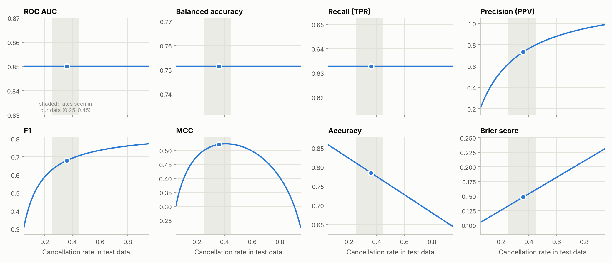
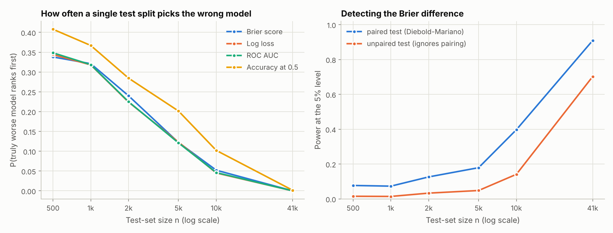
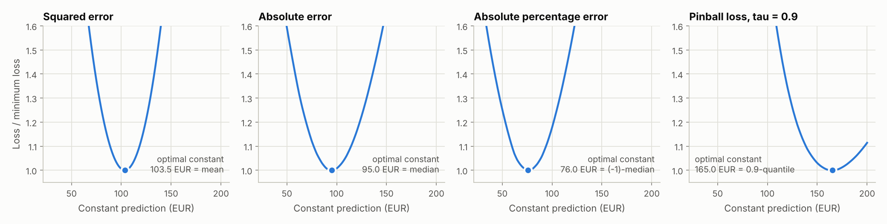
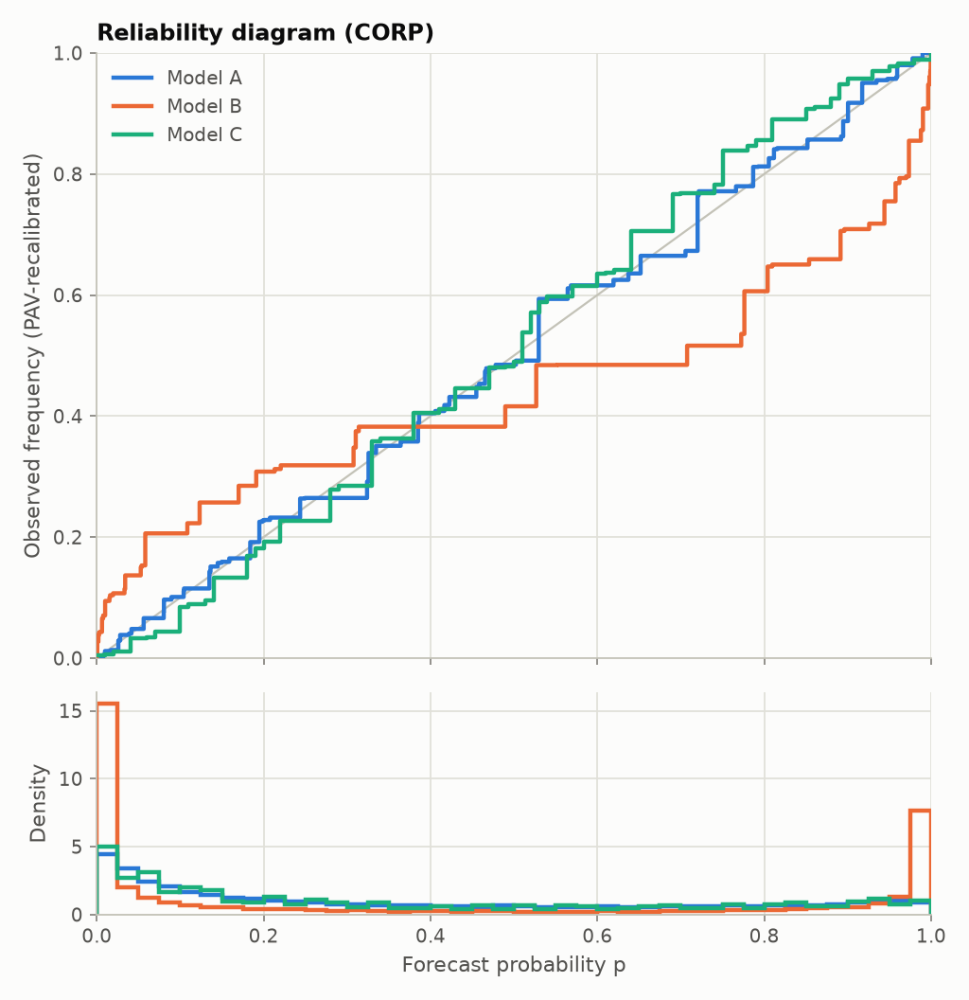
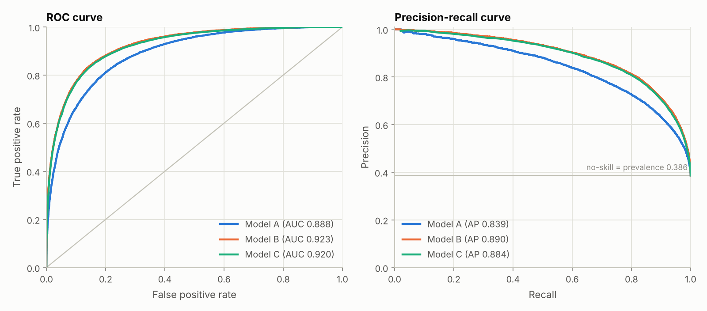
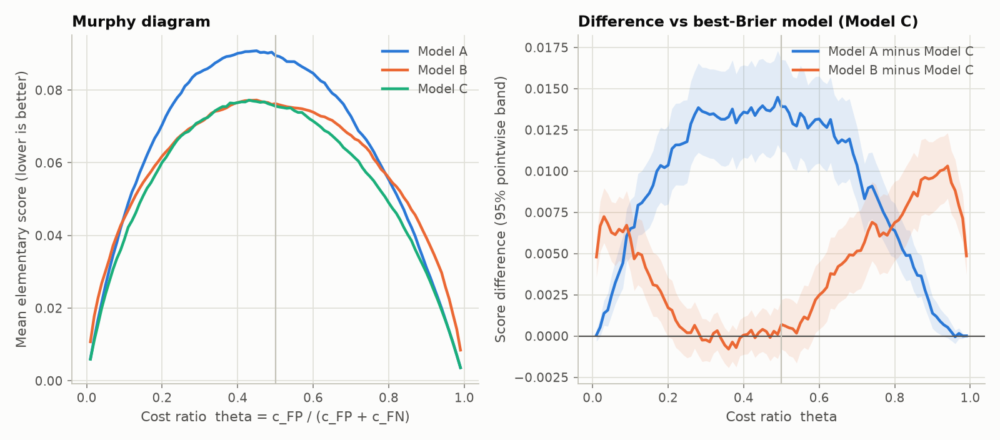

# Evaluating our Sprint 1 models: a metrics study

**Hotel Booking Demand: predicting whether a booking will be cancelled (`is_canceled`)**
DST Group 1 (Luke D, Thomas F, Morgan L) · research note by Luke D · October 2026 · revised 29 October 2026 for the group's random split

*Provenance: written by Luke D with AI assistance (Claude, Anthropic). Every derivation marked "verified" is checked numerically in [`test_evaluate.py`](test_evaluate.py), every number and figure is reproduced by [`simulations.py`](simulations.py), and the shared scoring tool is [`evaluate.py`](evaluate.py).*

## Summary

1. **One task, one frozen test set.** Every model outputs a probability that a booking is cancelled, for exactly the same test bookings. We use the split stored in `hotel_bookings_clean.csv` (the `split` column): a random 70/15/15 split, stratified by `is_canceled`, that keeps identical rows in the same set. We train on 83,324 bookings, tune on 17,331 and test once on 17,903, and each set covers arrivals from 1 July 2015 to 31 August 2017. Keeping identical rows together matters: 28.9% of the rows are exact copies of another row, and a lookup table with no ability to generalise reaches an AUC of 0.81 under a plain random split but 0.49 under ours. A random split cannot test predictions of *future* bookings, and rooms of one group booking that differ in a detail can still fall on both sides of it, so we add a chronological check and a check on unseen booking events ([§7.3](#73-what-the-test-set-must-imitate-leakage-duplicates-and-drift)).
2. **Morgan's "regression model" should be a logistic regression on `is_canceled`**, so that it can enter the same comparison. A regression on another target (for example the average daily rate) can be scored with [§8](#8-if-a-model-predicts-a-number-regression-metrics), but it cannot be compared head-to-head with the two classifiers.
3. **Primary metric: the Brier score**, also reported as a skill score against the training cancellation rate. It is strictly proper (only the true probabilities minimise it), bounded (one over-confident mistake by a random forest cannot dominate it, unlike log loss), splits exactly into a miscalibration part and a discrimination part, and equals the average decision cost over all cost ratios ([§3](#3-proper-scores-for-probabilities), [§6.1](#61-costs-the-bayes-threshold-and-the-murphy-diagram)).
4. **Always reported alongside it:** log loss, ROC AUC, the calibration intercept and slope with a reliability diagram, and threshold metrics (MCC, balanced accuracy, F1, expected cost) at a threshold fixed *before* anyone sees the test set.
5. **"Truly best" needs three things:** a paired 95% interval for the Brier difference that excludes zero after a Holm correction ([§7.1](#71-sampling-error-pairing-and-tests)); no reversal on the Murphy diagram over the range of cost ratios a hotel plausibly faces ([§6.1](#61-costs-the-bayes-threshold-and-the-murphy-diagram)); and the same ordering within each hotel ([§7.3](#73-what-the-test-set-must-imitate-leakage-duplicates-and-drift)). If these fail, we report the models as indistinguishable and explain why.
6. **Mechanics:** each of us saves `id,prediction` for the test bookings and runs `evaluate.py`, which computes all of the above with bootstrap intervals and paired tests ([§11](#11-using-evaluatepy)).

## Contents

1. [What we are evaluating, and why the metric matters](#1-what-we-are-evaluating-and-why-the-metric-matters)
2. [Set-up: what a metric asks for](#2-set-up-what-a-metric-asks-for)
3. [Proper scores for probabilities](#3-proper-scores-for-probabilities)
4. [Calibration: are the probabilities believable?](#4-calibration-are-the-probabilities-believable)
5. [Discrimination: does the model rank bookings well?](#5-discrimination-does-the-model-rank-bookings-well)
6. [Decisions: thresholds, costs, and why F1 is not neutral](#6-decisions-thresholds-costs-and-why-f1-is-not-neutral)
7. [Is the best model truly best?](#7-is-the-best-model-truly-best)
8. [If a model predicts a number: regression metrics](#8-if-a-model-predicts-a-number-regression-metrics)
9. [Worked example: three synthetic submissions](#9-worked-example-three-synthetic-submissions)
10. [Proposed evaluation protocol](#10-proposed-evaluation-protocol)
11. [Using evaluate.py](#11-using-evaluatepy)
12. [Metric cheat sheet](#12-metric-cheat-sheet)
13. [References](#references)

---

## 1. What we are evaluating, and why the metric matters

The brief asks us to "together agree and test a performance metric", to devote half of the effort to "exploring appropriate performance measures", and to "examine in what sense your group's best method is truly best". This note is my contribution to that half.

**The decision behind the data.** The Hotel Booking Demand data (Antonio, de Almeida & Nunes, 2019a) describe bookings at two Portuguese hotels, a resort hotel in the Algarve and a city hotel in Lisbon, for arrivals between 1 July 2015 and 31 August 2017. The raw Kaggle file has 119,390 rows, including columns that reveal the answer (§7.3). The group's cleaned file, `hotel_bookings_clean.csv`, which is what this note is computed from, has 118,558 rows and 30 columns: 39,664 resort bookings (28.0% cancelled) and 78,894 city bookings (41.9% cancelled), 37.3% cancelled overall. Cancellations leave rooms unsold, so hotels respond with overbooking and deposit policies; the dataset's authors collected these data to predict cancellations for revenue management (Antonio, de Almeida & Nunes, 2017, 2019b; Talluri & van Ryzin, 2004). Two features of that use shape how a model should be judged:

- *Hotels act on probabilities, not labels.* The expected number of cancellations for a night is $\sum_i \hat p_i$ over that night's bookings, with variance $\sum_i \hat p_i(1-\hat p_i)$ if bookings are independent. An overbooking level set from these numbers is only right if the probabilities are calibrated. A metric that looks only at labels (accuracy) or only at rankings (AUC) cannot see this.
- *Mistakes have unequal costs.* Wrongly expecting a guest to cancel and reselling the room means turning away ("walking") a guest who arrives: relocation, compensation and lost goodwill. Wrongly expecting a guest to arrive means an empty room. Which mistake is worse is the hotel's decision, so a good evaluation should show how the ranking of models changes with the cost ratio ([§6.1](#61-costs-the-bayes-threshold-and-the-murphy-diagram)).

**Our three models.** Luke is building a random forest, Thomas an XGBoost model and Morgan (probably) a logistic regression. Their probabilities tend to be distorted in different ways, which is exactly what the choice of metric interacts with:

- A random forest averages its trees. With fully grown trees its probabilities are vote fractions in steps of $1/T$ for $T$ trees, exactly 0 or 1 whenever all trees agree, and otherwise pushed away from 0 and 1, because averaging noisy trees rarely produces extreme values (Breiman, 2001; Niculescu-Mizil & Caruana, 2005).
- XGBoost with the `binary:logistic` objective minimises log loss directly (Chen & Guestrin, 2016), which usually gives sensible probabilities; like any flexible model it produces probabilities that are too extreme when it over-fits, which shows up as a calibration slope below 1 (Van Calster et al., 2019).
- Logistic regression is fitted by maximum likelihood, that is by minimising log loss. With an intercept, its score equations force $\sum_i \hat p_i = \sum_i y_i$ on the training data, so it is calibrated "in the large" there by construction.

**Training objectives are already metrics.** Logistic regression and XGBoost minimise log loss. A classification tree that splits on the Gini criterion greedily minimises the Brier score: for a node with $m$ bookings of which a fraction $\bar y$ were cancelled, a constant prediction $c$ has total squared error $m[\bar y(1-c)^2+(1-\bar y)c^2]$, which is minimised at $c=\bar y$ with value $m\bar y(1-\bar y)=\tfrac{m}{2}\,\mathrm{Gini}$, because $\mathrm{Gini}=1-\bar y^2-(1-\bar y)^2=2\bar y(1-\bar y)$ (Breiman et al., 1984). Splitting on entropy minimises log loss in the same way. So no metric is neutral between our models. My proposal of the Brier score is related to the criterion my own random forest uses, which is one more reason to always report log loss next to it and to use the Murphy diagram, which favours no single scoring rule, as the tie-breaker.

## 2. Set-up: what a metric asks for

**Notation.** Test bookings are $(x_i,y_i)$ for $i=1,\dots,n$, with $y_i=1$ if booking $i$ was cancelled. A model reports $\hat p_i=\hat p(x_i)\in[0,1]$. The cancellation rate is $\pi=P(Y=1)$ and the true conditional probability is $p^{\ast}(x)=P(Y=1\mid X=x)$.

### 2.1 Metrics as estimated risks

Most metrics are averages of a per-booking loss $S$:

$$
\widehat R_n=\frac{1}{n}\sum_{i=1}^{n} S(\hat p_i,y_i),\qquad R=\mathbb{E}\,S\big(\hat p(X),Y\big).
$$

If the test bookings are an i.i.d. sample that played no part in training, $\widehat R_n$ is unbiased for $R$ with variance $\sigma_S^2/n$, and by the central limit theorem $\widehat R_n\pm1.96\,s_S/\sqrt{n}$ is an approximate 95% interval. AUC, F1, MCC and average precision are *not* averages of per-booking losses (they are ratios or rank statistics), so their uncertainty needs the bootstrap or a special formula ([§7.1](#71-sampling-error-pairing-and-tests)).

### 2.2 Proper scoring rules

A scoring rule $S(p,y)$ for a binary outcome is **proper** if, whenever $Y\sim\mathrm{Bernoulli}(q)$,

$$
\mathbb{E}_q\,S(q,Y)\;\le\;\mathbb{E}_q\,S(p,Y)\qquad\text{for all } p\in[0,1],
$$

and **strictly proper** if equality holds only at $p=q$ (Gneiting & Raftery, 2007). Conditioning on $X$ shows why this matters for models: $\mathbb{E}\,S(\hat p(X),Y)=\mathbb{E}\big[\mathbb{E}_{p^{\ast}(X)}\,S(\hat p(X),Y)\big]$, and if $S$ is strictly proper the inner expectation is minimised pointwise by $\hat p(x)=p^{\ast}(x)$. **A strictly proper metric is optimised only by the true probabilities.** An improper metric can rank a deliberately distorted model above an honest one.

Two common traps (Figure 1):

- **Absolute error of a probability.** $\mathbb{E}_q\lvert p-Y\rvert=q(1-p)+(1-q)p=q+p(1-2q)$ is linear in $p$, so it is minimised by $p=0$ whenever $q < 1/2$ and by $p=1$ whenever $q > 1/2$. "MAE of the predicted probabilities" rewards over-confident 0/1 answers: it is improper.
- **Accuracy.** Misclassification at threshold ½ has expected value $q\,\mathbf{1}\lbrace p\le 1/2\rbrace+(1-q)\,\mathbf{1}\lbrace p > 1/2\rbrace$, so every $p$ on the correct side of ½ is equally good. It is proper but not strictly proper: it cannot tell a careful forecast from a careless one.



*Figure 1. Expected score of a forecast p for a booking whose true cancellation probability is q = 0.37, the overall cancellation rate. The Brier score and log loss are minimised exactly at p = q; absolute error is minimised by reporting 0; misclassification loss is flat on each side of 0.5. Source: `simulations.py`, S1.*

### 2.3 The same idea for numerical predictions

For a real-valued target, a scoring function $S(x,y)$ is **consistent** for a statistical functional $T$ (mean, median, quantile and so on) if $\mathbb{E}_F\,S(T(F),Y)\le\mathbb{E}_F\,S(x,Y)$ for every point prediction $x$ and every distribution $F$ (Gneiting, 2011). Squared error is consistent for the mean, absolute error for the median and the pinball loss for quantiles; under mild regularity conditions, a scoring function is consistent for the mean if and only if it is a Bregman function (Savage, 1971; Gneiting, 2011). The practical message is the same in both settings: **choosing a metric is choosing what the model is asked to predict.** [Section 8](#8-if-a-model-predicts-a-number-regression-metrics) works this out for regression.

## 3. Proper scores for probabilities

### 3.1 Log loss (logarithmic score, cross-entropy)

$$
\mathrm{LL}=-\frac{1}{n}\sum_{i=1}^{n}\Big[y_i\log\hat p_i+(1-y_i)\log(1-\hat p_i)\Big].
$$

**Strict propriety.** For $Y\sim\mathrm{Bernoulli}(q)$,

$$
\mathbb{E}_q\big[-Y\log p-(1-Y)\log(1-p)\big]
=\underbrace{-q\log q-(1-q)\log(1-q)}_{H(q)}
+\underbrace{q\log\frac{q}{p}+(1-q)\log\frac{1-q}{1-p}}_{\mathrm{KL}(q\,\Vert\,p)\,\ge\,0},
$$

and by Gibbs' inequality $\mathrm{KL}(q\Vert p)=0$ only when $p=q$. The expected log loss is the irreducible entropy of the outcome plus the information lost by reporting $p$ instead of $q$ (Good, 1952).

**Likelihood.** $-n\,\mathrm{LL}$ is the Bernoulli log-likelihood of the test labels, so log loss is the out-of-sample version of what logistic regression and XGBoost minimise in training. A natural skill score is McFadden's (1974) $1-\mathrm{LL}/\mathrm{LL}_0$, where $\mathrm{LL}_0=H(\bar y)$ is the log loss of always predicting the base rate: 0.658 nats at the test-set cancellation rate of 0.368.

**Unboundedness.** $S(p,1)=-\log p\to\infty$ as $p\to 0$, so software clips probabilities. scikit-learn (Pedregosa et al., 2011) replaces $p$ by $\min\lbrace\max(p,\varepsilon),1-\varepsilon\rbrace$ with $\varepsilon\approx 2.2\times10^{-16}$, so one booking predicted with probability exactly 0 that is then cancelled costs $-\log\varepsilon\approx 36.0$ nats, adding about 0.0020 to the mean over 17,903 test bookings. This matters for us because random-forest probabilities are often exactly 0 or 1 (817 of 17,903 in the forest-style model of [§9](#9-worked-example-three-synthetic-submissions)). Under log loss a handful of confident misses can decide a comparison. That is the score working as designed ("never claim certainty you do not have"), but it means I should recalibrate my forest on validation data before submitting; Platt scaling, for example, never returns exactly 0 or 1.

### 3.2 The Brier score

$$
\mathrm{BS}=\frac{1}{n}\sum_{i=1}^{n}(\hat p_i-y_i)^2,
$$

the mean squared error of the probability (Brier, 1950).

**Strict propriety.** Using $Y^2=Y$,

$$
\mathbb{E}_q(p-Y)^2=p^2-2pq+q=(p-q)^2+q(1-q),
$$

which is uniquely minimised at $p=q$; the remainder $q(1-q)$ is the irreducible Bernoulli variance.

**Boundedness.** Every term lies in $[0,1]$, so one confident miss costs at most $1/n$, against roughly $36/n$ under clipped log loss.

**Skill score.** A constant forecast $r$ has Brier score $\bar y(1-\bar y)+(\bar y-r)^2$. Taking $r$ to be the training cancellation rate gives a benchmark that uses no test information, and $\mathrm{BSS}=1-\mathrm{BS}/\mathrm{BS}_{\mathrm{ref}}$ reads as "the fraction of the benchmark's error removed".

**Decompositions.** If the forecasts take $K$ distinct values $f_k$, each used $n_k$ times with observed cancellation frequency $\bar o_k$, Murphy (1973) showed that

$$
\mathrm{BS}=\underbrace{\frac{1}{n}\sum_{k=1}^{K}n_k(f_k-\bar o_k)^2}_{\text{reliability (REL)}}
-\underbrace{\frac{1}{n}\sum_{k=1}^{K}n_k(\bar o_k-\bar y)^2}_{\text{resolution (RES)}}
+\underbrace{\bar y(1-\bar y)}_{\text{uncertainty (UNC)}}.
$$

REL measures miscalibration, RES rewards forecasts that separate high-risk from low-risk bookings, and UNC depends only on the data. Continuous forecasts must first be binned, which adds within-bin terms and makes the answer depend on the bins (Stephenson, Coelho & Jolliffe, 2008). The **CORP decomposition** (Dimitriadis, Gneiting & Jordan, 2021) avoids binning. Let $\hat p^{\mathrm{PAV}}$ be the isotonic regression of $y$ on $\hat p$, computed by the pool-adjacent-violators algorithm, which is the best non-decreasing recalibration of the model, and let $\bar S(\cdot)$ denote a mean score. Then, exactly,

$$
\bar S(\hat p)=\underbrace{\bar S(\hat p)-\bar S(\hat p^{\mathrm{PAV}})}_{\mathrm{MCB}\,\ge\,0}
-\underbrace{\Big(\bar S(\bar y)-\bar S(\hat p^{\mathrm{PAV}})\Big)}_{\mathrm{DSC}\,\ge\,0}
+\underbrace{\bar S(\bar y)}_{\mathrm{UNC}}.
$$

MCB is non-negative because the identity map is one of the non-decreasing recalibrations that PAV optimises over, and DSC is non-negative because the constant $\bar y$ is another. The PAV solution is optimal for every proper scoring rule simultaneously, so the decomposition works for log loss as well (Dimitriadis et al., 2021); `evaluate.py` reports both (verified: MCB - DSC + UNC reproduces the score exactly). The decomposition answers a question we are bound to face: *is a model behind because it ranks bookings worse (lower DSC), or only because its probabilities are mis-scaled (higher MCB), which recalibration could fix?*

### 3.3 Choosing between the two

Both scores are strictly proper, yet they can rank two models differently: in the worked example of [§9](#9-worked-example-three-synthetic-submissions) the Brier score prefers Model B to Model A while log loss prefers A to B, and both differences are statistically significant. [Section 6.1](#61-costs-the-bayes-threshold-and-the-murphy-diagram) explains why: the two scores weight decisions at different cost ratios differently (see also Merkle & Steyvers, 2013). That section is the basis of my recommendation to make the Brier score primary and to report log loss next to it.

## 4. Calibration: are the probabilities believable?

A model is **calibrated** if $P(Y=1\mid \hat p(X)=p)=p$ for every $p$ (Dawid, 1982). Calibration is necessary but not sufficient: always predicting the base rate is perfectly calibrated and useless. The aim is to "maximise sharpness subject to calibration" (Gneiting, Balabdaoui & Raftery, 2007), and the Murphy and CORP decompositions above are that trade-off written as an identity.

**Reliability diagram.** Plot an estimate of $P(Y=1\mid\hat p=p)$ against $p$. The classic version bins the forecasts, and its shape can change with the number of bins. The CORP version plots the PAV fit instead, which is stable, needs no tuning and connects directly to MCB (Dimitriadis et al., 2021). `evaluate.py` draws CORP diagrams (Figure 3a).

**Calibration intercept and slope** (Cox, 1958). Fit the logistic recalibration model

$$
\operatorname{logit}P(Y=1\mid\hat p)=a+b\,\operatorname{logit}(\hat p).
$$

A perfectly calibrated model has $a=0$ and $b=1$. The **slope** diagnoses spread: $b < 1$ means the probabilities are too extreme (over-confident, typical of over-fitting) and $b > 1$ that they are too timid (under-confident, typical of averaged votes). The **calibration-in-the-large** intercept is $a$ re-estimated with $b$ fixed at 1; it checks whether the model predicts the right overall cancellation rate (Van Calster et al., 2016, 2019).

**Expected calibration error.** $\mathrm{ECE}=\sum_b \frac{n_b}{n}\lvert\bar y_b-\bar p_b\rvert$ over equal-width bins (Naeini, Cooper & Hauskrecht, 2015; Guo et al., 2017) is popular but biased upwards in finite samples and dependent on the bins (Kumar, Liang & Ma, 2019). It is useful as a description, not as a criterion.

**A test.** Spiegelhalter's (1986) test asks whether the Brier score is larger than calibration alone would imply. Since $(\hat p-y)^2-\hat p(1-\hat p)=(y-\hat p)(1-2\hat p)$, which has mean 0 and variance $(1-2\hat p)^2\hat p(1-\hat p)$ when $Y\sim\mathrm{Bernoulli}(\hat p)$,

$$
z=\frac{\sum_i (y_i-\hat p_i)(1-2\hat p_i)}{\sqrt{\sum_i (1-2\hat p_i)^2\,\hat p_i(1-\hat p_i)}}\;\approx\;\mathcal{N}(0,1)
$$

under calibration. The Hosmer–Lemeshow (1980) test is more common, but its result depends on how bookings are grouped and, with over 40,000 test bookings, it will flag even trivially small miscalibration as significant. I suggest reporting the intercept, slope and MCB with intervals rather than a single p-value.

**Recalibration.** Platt scaling (Platt, 1999) fits the Cox model on *validation* data and applies it to new predictions; isotonic regression (Zadrozny & Elkan, 2002) is the non-parametric version. Both are monotone, so they leave AUC unchanged and can only reduce MCB. Any recalibration must be fitted on validation data, never on the test set.

> **What this means for us.** Calibration is the property an overbooking decision uses most directly. We should look at every model's reliability diagram and calibration slope. A model that wins on AUC but loses on the Brier score because of a large MCB should be described as "ranks well, needs recalibration", not as the best model.

## 5. Discrimination: does the model rank bookings well?

### 5.1 The ROC curve and AUC

For a threshold $t$, let $\mathrm{TPR}(t)=P(\hat p > t\mid Y=1)$ and $\mathrm{FPR}(t)=P(\hat p > t\mid Y=0)$. The ROC curve traces $(\mathrm{FPR}(t),\mathrm{TPR}(t))$ as $t$ falls from 1 to 0 (Fawcett, 2006).

**AUC is a probability** (Bamber, 1975; Hanley & McNeil, 1982). Let $S_1$ and $S_0$ be the scores of a randomly chosen cancelled and a randomly chosen kept booking, with distribution functions $F_1,F_0$ and densities $f_1,f_0$. Parametrising the curve by $t$ gives $\mathrm{TPR}=1-F_1(t)$ and $d\,\mathrm{FPR}=-f_0(t)\,dt$, so

$$
\mathrm{AUC}=\int_0^1\mathrm{TPR}\;d\,\mathrm{FPR}=\int_{-\infty}^{\infty}\big(1-F_1(t)\big)\,f_0(t)\,dt=P(S_1 > S_0),
$$

with ties counted one half when scores are discrete. The sample version is the Mann–Whitney statistic

$$
\widehat{\mathrm{AUC}}=\frac{1}{n_1n_0}\sum_{i:\,y_i=1}\;\sum_{j:\,y_j=0}\Big(\mathbf{1}\lbrace\hat p_i > \hat p_j\rbrace+\tfrac{1}{2}\,\mathbf{1}\lbrace\hat p_i=\hat p_j\rbrace\Big)=\frac{R_1-n_1(n_1+1)/2}{n_1n_0},
$$

where $n_1,n_0$ count cancelled and kept bookings and $R_1$ is the sum of the mid-ranks of the cancelled ones (verified against scikit-learn). The Gini coefficient used in credit scoring is $2\,\mathrm{AUC}-1$.

**Consequences.** AUC depends only on the *order* of the scores, so any strictly increasing transformation of $\hat p$ leaves it unchanged: it is blind to calibration, and dividing every probability by ten would not change it. It is also unaffected by the cancellation rate, because it is built from the two class-conditional distributions.

**Uncertainty and comparison.** DeLong, DeLong & Clarke-Pearson (1988) write $\widehat{\mathrm{AUC}}$ as the mean of "structural components", $V_{10}(i)=\frac{1}{n_0}\sum_j\psi(\hat p_i,\hat p_j)$ for each cancelled booking $i$ and $V_{01}(j)=\frac{1}{n_1}\sum_i\psi(\hat p_i,\hat p_j)$ for each kept booking $j$, where $\psi(a,b)=\mathbf{1}\lbrace a > b\rbrace+\tfrac12\mathbf{1}\lbrace a=b\rbrace$. With $s_{10}^2$ and $s_{01}^2$ their sample variances,

$$
\widehat{\mathrm{Var}}\big(\widehat{\mathrm{AUC}}\big)=\frac{s_{10}^2}{n_1}+\frac{s_{01}^2}{n_0}.
$$

For two models scored on the same bookings the same construction gives a covariance, and $z=(\widehat{\mathrm{AUC}}_A-\widehat{\mathrm{AUC}}_B)/\sqrt{\widehat{\mathrm{Var}}_A+\widehat{\mathrm{Var}}_B-2\,\widehat{\mathrm{Cov}}_{AB}}$ is approximately standard normal. `evaluate.py` uses the fast algorithm of Sun & Xu (2014) (verified against a brute-force computation).

**Is AUC a coherent yardstick?** Hand (2009) showed that AUC equals an expected minimum misclassification loss in which the distribution over cost ratios depends on the classifier's own scores, so two classifiers are judged with different cost weightings; he proposed the H-measure instead. Flach, Hernández-Orallo & Ferri (2011) replied that AUC is coherent if thresholds are spread uniformly over predicted-positive *rates* rather than over costs. Hernández-Orallo, Flach & Ferri (2012) unify the debate: with cost proportions spread uniformly, the Brier score is the expected loss when the threshold is set equal to the cost proportion using the model's probabilities, and AUC is a linear function of the expected loss when thresholds are set from predicted-positive rates. Because our models produce probabilities and a hotel would act on them at its own cost ratio, the Brier-score view is the natural one for us; AUC remains the clearest single summary of ranking quality.

### 5.2 Precision and recall

By Bayes' theorem, precision at threshold $t$ is

$$
\mathrm{PPV}(t)=\frac{\pi\,\mathrm{TPR}(t)}{\pi\,\mathrm{TPR}(t)+(1-\pi)\,\mathrm{FPR}(t)},
$$

so precision–recall curves and average precision, $\mathrm{AP}=\sum_k(R_k-R_{k-1})P_k$ over the distinct thresholds, move whenever the cancellation rate moves, even if the model does not change. The no-skill level of AP is $\pi$, not ½. One model dominates another in ROC space if and only if it does in precision–recall space (Davis & Goadrich, 2006), and precision–recall curves are the more informative of the two when positives are rare (Saito & Rehmsmeier, 2015). With cancellation rates between 28% and 42% we are not in that regime, so I suggest AP as a secondary number only.

### 5.3 Kolmogorov–Smirnov distance and Youden's index

For any model that does better than chance, $\max_t\,[\mathrm{TPR}(t)-\mathrm{FPR}(t)]$ is the Kolmogorov–Smirnov distance between the score distributions of cancelled and kept bookings, and the best Youden index $J=\mathrm{TPR}+\mathrm{TNR}-1$ the model can achieve with any threshold (Youden, 1950). `evaluate.py` reports it as `max_youden_ks` (verified against `scipy.stats.ks_2samp`).

## 6. Decisions: thresholds, costs, and why F1 is not neutral

Thresholding $\hat p$ at $t$ gives counts TP, FP, FN and TN. Write $Q=\pi\,\mathrm{TPR}+(1-\pi)\,\mathrm{FPR}$ for the share of bookings flagged as likely cancellations. The common threshold metrics are:

| Metric | Definition | In terms of $\pi$, TPR and FPR |
| --- | --- | --- |
| Accuracy | $(\mathrm{TP}+\mathrm{TN})/n$ | $\pi\,\mathrm{TPR}+(1-\pi)(1-\mathrm{FPR})$ |
| Balanced accuracy | $(\mathrm{TPR}+\mathrm{TNR})/2$ | $(1+\mathrm{TPR}-\mathrm{FPR})/2$ |
| Precision (PPV) | $\mathrm{TP}/(\mathrm{TP}+\mathrm{FP})$ | $\pi\,\mathrm{TPR}/Q$ |
| F1 | $2\mathrm{TP}/(2\mathrm{TP}+\mathrm{FP}+\mathrm{FN})$ | $2\pi\,\mathrm{TPR}/(\pi+Q)$ |
| MCC | $\dfrac{\mathrm{TP}\cdot\mathrm{TN}-\mathrm{FP}\cdot\mathrm{FN}}{\sqrt{(\mathrm{TP}+\mathrm{FP})(\mathrm{TP}+\mathrm{FN})(\mathrm{TN}+\mathrm{FP})(\mathrm{TN}+\mathrm{FN})}}$ | $\sqrt{\dfrac{\pi(1-\pi)}{Q(1-Q)}}\,(\mathrm{TPR}-\mathrm{FPR})$ |
| Cohen's kappa | $(p_o-p_e)/(1-p_e)$ | $p_o$ = accuracy, $p_e=\pi Q+(1-\pi)(1-Q)$ |

Some facts worth knowing:

- **Balanced accuracy** is the area under the two-segment ROC "curve" through the single operating point $(\mathrm{FPR},\mathrm{TPR})$: that area is $\tfrac12\mathrm{FPR}\cdot\mathrm{TPR}+\tfrac12(1-\mathrm{FPR})(1+\mathrm{TPR})=(1+\mathrm{TPR}-\mathrm{FPR})/2$ (Brodersen et al., 2010).
- **MCC** follows from the table in population proportions: $\mathrm{TP}\cdot\mathrm{TN}-\mathrm{FP}\cdot\mathrm{FN}=\pi(1-\pi)(\mathrm{TPR}-\mathrm{FPR})$, $(\mathrm{TP}+\mathrm{FP})(\mathrm{TN}+\mathrm{FN})=Q(1-Q)$ and $(\mathrm{TP}+\mathrm{FN})(\mathrm{TN}+\mathrm{FP})=\pi(1-\pi)$. It is the Pearson (phi) correlation between $y$ and $\hat y$ (Matthews, 1975), $n\,\mathrm{MCC}^2$ is the $\chi^2$ statistic of the 2×2 table, and $\mathrm{MCC}^2=\mathrm{BM}\times\mathrm{MK}$ with informedness $\mathrm{BM}=\mathrm{TPR}+\mathrm{TNR}-1$ and markedness $\mathrm{MK}=\mathrm{PPV}+\mathrm{NPV}-1$ (Powers, 2011). It uses all four cells and treats the classes symmetrically, which is why Chicco & Jurman (2020) recommend it over F1 and accuracy.
- **Cohen's kappa** (Cohen, 1960) behaves erratically when the marginal distributions differ and can rank classifiers inconsistently (Delgado & Tibau, 2019); I would not use it.

All of these depend on a threshold, and most of them on $\pi$. The next three subsections deal with each problem.

### 6.1 Costs, the Bayes threshold and the Murphy diagram

Let $c_{\mathrm{FN}}$ be the cost of failing to flag a booking that is then cancelled (an unsold room) and $c_{\mathrm{FP}}$ the cost of flagging a booking whose guest then arrives (if the room was resold, a walked guest). Flagging booking $i$ costs $(1-\hat p_i)\,c_{\mathrm{FP}}$ in expectation and not flagging it costs $\hat p_i\,c_{\mathrm{FN}}$, so with calibrated probabilities the cost-minimising rule is (Elkan, 2001)

$$
\text{flag booking } i \iff \hat p_i > \theta^{\ast}=\frac{c_{\mathrm{FP}}}{c_{\mathrm{FP}}+c_{\mathrm{FN}}}.
$$

Equal costs give $\theta^{\ast}=1/2$; if walking a guest costs twice as much as an empty room, $\theta^{\ast}=2/3$. These cost ratios are illustrative assumptions: nothing in our data tells us a hotel's costs.

Scaling the costs to $1-\theta$ per false negative and $\theta$ per false positive gives the **elementary score**

$$
S_\theta(p,y)=(1-\theta)\,\mathbf{1}\lbrace y=1,\ p\le\theta\rbrace+\theta\,\mathbf{1}\lbrace y=0,\ p > \theta\rbrace,
$$

the cost per booking of a hotel that acts at threshold $\theta$. The result that connects decisions to the proper scores of §3 is the following.

**Theorem** (Schervish, 1989; Ehm, Gneiting, Jordan & Krüger, 2016). Every proper scoring rule for a binary outcome is, up to terms that do not depend on the forecast, a mixture of elementary scores: $S(p,y)=\int_0^1 S_\theta(p,y)\,dH(\theta)$ for some non-negative measure $H$. In particular,

$$
(p-y)^2=2\int_0^1 S_\theta(p,y)\,d\theta,
\qquad
-y\log p-(1-y)\log(1-p)=\int_0^1 \frac{S_\theta(p,y)}{\theta(1-\theta)}\,d\theta .
$$

*Proof of the two examples.* If $y=1$ then $S_\theta(p,1)=(1-\theta)\,\mathbf{1}\lbrace\theta\ge p\rbrace$, so $2\int_p^1(1-\theta)\,d\theta=(1-p)^2$ and $\int_p^1\frac{1-\theta}{\theta(1-\theta)}\,d\theta=\int_p^1\frac{d\theta}{\theta}=-\log p$. If $y=0$ then $S_\theta(p,0)=\theta\,\mathbf{1}\lbrace\theta < p\rbrace$, so $2\int_0^p\theta\,d\theta=p^2$ and $\int_0^p\frac{d\theta}{1-\theta}=-\log(1-p)$. (Verified by numerical integration.) $\blacksquare$

In the same way, the misclassification loss at threshold ½ is $2\,S_{1/2}$: a point mass at $\theta=1/2$. This gives the most useful reading of the three scores in this note:

- **The Brier score is twice the average decision cost over all cost ratios, weighted uniformly.**
- **Log loss weights cost ratio $\theta$ by $1/(\theta(1-\theta))$:** a weight of 4 at $\theta=1/2$ but about 101 at $\theta=0.01$ or $\theta=0.99$. It is dominated by decisions at extreme cost ratios, which is the same as saying it cares a great deal about whether a model can tell a 1% risk from a 0.1% risk.
- **Accuracy looks at a single cost ratio**, $\theta=1/2$.

The **Murphy diagram** (Ehm et al., 2016) plots each model's mean elementary score $\bar S_\theta=\frac1n\sum_i S_\theta(\hat p_i,y_i)$ against $\theta$. If model A's curve lies below model B's at every $\theta$, then A is preferred by *every* proper scoring rule and by every hotel, whatever its costs: the strongest possible meaning of "truly best". If the curves cross, the ranking depends on the costs, and the Brier score and log loss may disagree (Figure 3c). For a hotel, a $\theta$ close to 0 (walking a guest is almost free) or close to 1 (walking a guest is fifty times worse than an empty room) is implausible. A region such as $0.3\le\theta\le0.8$, meaning a walked guest costs between about 0.4 and 4 times an empty room, is a defensible region of interest, and over it the uniform weighting of the Brier score is closer to the decision problem than the weighting of log loss. This is my main argument for making the Brier score primary.

### 6.2 F1 hides a threshold and a cost ratio

**Theorem** (Lipton, Elkan & Narayanaswamy, 2014). For calibrated probabilities, the F1-maximising rule flags a booking if and only if $\hat p > F_1^{\ast}/2$, where $F_1^{\ast}$ is the largest achievable F1.

*Proof sketch, using expected counts in a large test set.* Write $F_1=N/D$ with $N=2\,\mathrm{TP}$ and $D=2\,\mathrm{TP}+\mathrm{FP}+\mathrm{FN}$. Flagging one more booking with cancellation probability $p$ changes the expected counts by $\Delta\mathrm{TP}=p$, $\Delta\mathrm{FP}=1-p$ and $\Delta\mathrm{FN}=-p$, so $N$ becomes $N+2p$ and $D$ becomes $D+1$. Then $(N+2p)/(D+1) > N/D$ if and only if $p > N/(2D)=F_1/2$, and at the optimum the threshold equals $F_1^{\ast}/2$. $\blacksquare$

Because $F_1^{\ast}\le1$, the F1-optimal threshold is always below ½, so F1 acts like a cost-sensitive rule whose implied cost ratio, $\theta=F_1^{\ast}/2$, depends on how good the model is. Hand & Christen (2018) reach the same conclusion by writing F1 as a weighted mean of precision and recall whose weights depend on the classifier. Two models compared on F1 are therefore judged with different implicit costs, which is a poor property for a shared yardstick. F1, the harmonic mean of precision and recall (van Rijsbergen, 1979), also ignores true negatives entirely.

### 6.3 Thresholds must be fixed before the test set is seen

Choosing $t$ to maximise a metric on the test set overstates performance, because the maximum of noisy estimates is biased upwards. Each threshold, or the shared $\theta^{\ast}$, must be fixed on validation data.

### 6.4 Which metrics move when the cancellation rate moves?

Under **label shift**, the distribution of features within each class, $P(X\mid Y)$, stays fixed while $\pi$ changes (Moreno-Torres et al., 2012). A model's TPR and FPR at a fixed threshold then do not change, and neither do balanced accuracy, Youden's $J$ or AUC. Everything that mixes the two classes in proportion to $\pi$ does change: accuracy, precision, F1, MCC, kappa, the Brier score and log loss. The probabilities also become miscalibrated. By Bayes' Theorem $\operatorname{logit}P(Y=1\mid x)=\operatorname{logit}\pi+\log\big(f_1(x)/f_0(x)\big)$, so a model calibrated at the training rate $\pi_0$ has a calibration-in-the-large error of $\operatorname{logit}\pi-\operatorname{logit}\pi_0$ at rate $\pi$ (Saerens, Latinne & Decaestecker, 2002).

This is not hypothetical for us. The cancellation rate is 28.0% at the resort and 41.9% in the city, quarterly rates range from 31% to 44%, and removing duplicate rows changes the overall rate from 37.3% to 27.9%. Our random split keeps the three sets close (37.3% in training, 37.5% in validation and 36.8% in test), but a hotel applying a model to next season's bookings, or to the other hotel, would not be so lucky. Figure 2 holds one model fixed and changes only the cancellation rate of the test set.



*Figure 2. One fixed model (binormal scores, AUC 0.85, calibrated at the training rate 0.373, threshold 0.5) scored on test sets that differ only in their cancellation rate. Shaded: the range of rates that occur in our data. Dot: the training rate. Source: `simulations.py`, S2.*

| Test-set cancellation rate | 0.279 (deduplicated) | 0.280 (resort) | 0.368 (test) | 0.373 (training) | 0.419 (city) |
| --- | --- | --- | --- | --- | --- |
| Recall, balanced accuracy, AUC | 0.648, 0.755, 0.850 | unchanged | unchanged | unchanged | unchanged |
| Precision | 0.644 | 0.645 | 0.731 | 0.736 | 0.771 |
| F1 | 0.646 | 0.646 | 0.687 | 0.689 | 0.704 |
| MCC | 0.508 | 0.508 | 0.524 | 0.524 | 0.526 |
| Accuracy | 0.802 | 0.802 | 0.783 | 0.782 | 0.772 |
| Brier score | 0.138 | 0.138 | 0.149 | 0.150 | 0.156 |
| Calibration-in-the-large | −0.43 | −0.43 | −0.02 | 0.00 | +0.19 |

> **What this means for us.** With the model unchanged, precision differs by 0.13 and F1 by 0.06 between the two hotels, and accuracy *falls* as the cancellation rate rises towards one half. Scores computed on different hotels, periods or deduplication choices are not comparable, so all three of us must be scored on the identical test set. Metrics that ignore the cancellation rate (balanced accuracy, AUC) carry over between hotels but say nothing about calibration. The proper scores penalise the shift itself, which is right: a hotel using miscalibrated probabilities would set its overbooking level wrongly.

## 7. Is the best model truly best?

### 7.1 Sampling error, pairing and tests

Even 17,903 test bookings leave noticeable noise. For an accuracy near 0.8 the standard error is $\sqrt{0.8\times0.2/17{,}903}\approx0.0030$, so a 95% interval is about ±0.006, and the bookings are not independent (29% of the test rows are copies of another test row, §7.3), so the true interval is wider. Comparisons are much sharper than separate intervals suggest, because every model is scored on the same bookings. With per-booking loss differences $d_i=S(\hat p^{A}_i,y_i)-S(\hat p^{B}_i,y_i)$,

$$
\mathrm{Var}(\bar d)=\frac{\sigma_A^2+\sigma_B^2-2\rho\,\sigma_A\sigma_B}{n},
$$

and since our models will tend to find the same bookings hard, the correlation $\rho$ will be high and the paired variance small. The tests in `evaluate.py` are:

- **Diebold–Mariano** (Diebold & Mariano, 1995) for the Brier score, log loss and regression losses: $\mathrm{DM}=\bar d/\sqrt{\widehat{\mathrm{LRV}}/n}$, approximately standard normal under $H_0:\mathbb{E}\,d=0$. Here $\widehat{\mathrm{LRV}}$ is the sample variance of the $d_i$, or a Newey–West (1987) long-run variance if errors are correlated in time (option `--hac-lag`).
- **McNemar's test** (McNemar, 1947) for accuracy at a fixed threshold. If $b$ bookings are classified correctly only by A and $c$ only by B, then under $H_0$ we have $b\mid(b+c)\sim\mathrm{Bin}(b+c,\tfrac12)$; I use the mid-p version recommended by Fagerland, Lydersen & Laake (2013). Dietterich (1998) recommends McNemar's test when only one test set is available.
- **DeLong's test** for AUC ([§5.1](#51-the-roc-curve-and-auc)).
- **The paired bootstrap** (Efron & Tibshirani, 1993) for everything else, including F1, MCC and the calibration slope: resample bookings with replacement, recompute every model's metric on the same resample, and take percentiles of the differences. A cluster bootstrap (`--cluster`) resamples whole groups of dependent bookings, such as the identical rows of one group booking.
- **Holm's correction** (Holm, 1979) for the three pairwise comparisons: with ordered p-values $p_{(1)}\le p_{(2)}\le p_{(3)}$, report $\tilde p_{(k)}=\max_{j\le k}\min\lbrace 1,(m-j+1)\,p_{(j)}\rbrace$ with $m=3$.

**Simulation.** Two calibrated models with a small true difference (population AUC 0.876 against 0.871; Brier score 0.1352 against 0.1384) were scored on 1,000 independent test sets of each size. The table gives the share of test sets in which the truly worse model came out ahead (an exact tie counts one half) and the power of the paired and unpaired tests of the Brier difference at the 5% level.

| Test-set size | 500 | 1,000 | 2,000 | 5,000 | 10,000 | 17,903 |
| --- | --- | --- | --- | --- | --- | --- |
| Worse model wins: Brier score | 0.361 | 0.321 | 0.236 | 0.131 | 0.053 | 0.024 |
| Worse model wins: log loss | 0.354 | 0.314 | 0.219 | 0.125 | 0.049 | 0.018 |
| Worse model wins: ROC AUC | 0.357 | 0.311 | 0.221 | 0.130 | 0.044 | 0.019 |
| Worse model wins: accuracy | 0.413 | 0.362 | 0.299 | 0.197 | 0.110 | 0.070 |
| Power, paired test | 0.082 | 0.071 | 0.132 | 0.172 | 0.392 | 0.536 |
| Power, unpaired test | 0.015 | 0.007 | 0.029 | 0.048 | 0.133 | 0.254 |



*Figure 4. Left: how often a single test split ranks the truly worse model first. Right: power of the paired Diebold–Mariano test and of an unpaired test that ignores the pairing. Source: `simulations.py`, S4.*

> **What this means for us.** (1) Accuracy is the noisiest yardstick because it throws away how far each probability is from the truth: with 5,000 test bookings it picks the worse model 20% of the time, against about 13% for the proper scores, and at our test-set size 7% against 2%. (2) Pairing is worth a lot of data: at 10,000 bookings the paired test detects the difference 39% of the time against 13% for the unpaired one, and at our test-set size 54% against 25%. (3) With our 17,903 test bookings, a real but small difference (0.003 in Brier score) goes undetected in almost half of all test sets, and these bookings contain duplicates, so "no significant difference" is a legitimate result that we should report honestly rather than declaring a winner. (4) Statistical and practical significance differ: in [§9](#9-worked-example-three-synthetic-submissions) two models differ in AUC by 0.002 with $p\approx2\times10^{-10}$, yet which of them is better depends on the hotel's costs.

### 7.2 Validation and cross-validation

Hyperparameter tuning, threshold choice and recalibration must use the training and validation sets only. The cross-validated score of the configuration we *selected* is optimistically biased (Varma & Simon, 2006; Cawley & Talbot, 2010), so the frozen test set is the only unbiased basis for comparing our three submissions. Cross-validation estimates the average performance of the fitting *procedure* over training sets rather than of the model actually fitted (Bates, Hastie & Tibshirani, 2024), and naive standard errors from resampling are too small because the training sets overlap (Bengio & Grandvalet, 2004). For $J$ random train/test splits, the corrected resampled t-test of Nadeau & Bengio (2003) replaces the naive variance factor $1/J$ by $1/J+n_{\text{test}}/n_{\text{train}}$. Folds should respect the structure of the data (Roberts et al., 2017): on our split, any folds inside the training set must keep identical rows together, as the split itself does (`GroupKFold` with the `block` column of [§11](#11-using-evaluatepy)). For the chronological check of §7.3, forward-chaining ("rolling-origin") validation within the earlier period (Tashman, 2000) imitates deployment.

### 7.3 What the test set must imitate: leakage, duplicates and drift

**Leakage** is information in the features that would not be available when the prediction is made (Kaufman et al., 2012), and it is a widespread cause of irreproducible machine-learning results across scientific fields (Kapoor & Narayanan, 2023). The dataset's documentation states that each observation's data point time is the day before arrival (Antonio et al., 2019a), whereas a revenue manager wants a prediction when the booking is made. The raw Kaggle file contains columns that violate that, and the group's cleaned file has already dropped them. This table records why, from my checks on the raw file, so that nobody adds them back:

| Column in the raw file | Evidence in the raw data | In our cleaned file |
| --- | --- | --- |
| `reservation_status` | "Canceled" or "No-Show" for every cancelled booking, "Check-Out" for every other: it is the label | dropped |
| `reservation_status_date` | on or before arrival for every cancellation, on or after arrival for every stay | dropped |
| `assigned_room_type` | 5.4% cancelled when it differs from the reserved type, 41.6% when the same; rooms are assigned near arrival | dropped |
| `required_car_parking_spaces` | no cancellations at all among the 7,416 bookings that requested parking | dropped |
| `booking_changes` | documented as counted until check-in or cancellation | dropped |

The cleaned file also lacks `arrival_date_day_of_month` (it carries a single `arrival_date` instead), `company` (replaced by `has_company`), `days_in_waiting_list`, and 832 rows of the raw file. One column deserves a group decision: `deposit_type` is available at booking time, but 99.4% of "Non Refund" bookings (12.3% of all rows) were cancelled, so every model will get much of its skill from it; I suggest reporting the metrics also on the "No Deposit" bookings alone.

**Duplicates.** The cleaned file still contains 34,213 rows (28.9%) that are exact copies of an earlier row (identical in every column except `split`). They come in 8,571 blocks of 2 to 180 identical rows; 46% of duplicated rows are in the "Groups" market segment and 32% come from offline travel agents and tour operators, so they are most plausibly several rooms booked together (the data contain no booking identifier). 98% of "Non Refund" bookings are duplicated rows. Deduplicating changes the cancellation rate from 37.3% to 27.9%. The shares are similar in our three sets: 29% of training rows, 27% of validation rows and 29% of test rows are copies. Under a plain random split, copies of one booking land on both sides; our split prevents this by assigning each block of identical rows to a single set. To measure how much a split flatters a model, I scored a "memoriser" that knows nothing except a lookup table: for each test booking it returns the cancellation rate of training rows that are identical in every feature except the arrival date (excluded so that a chronological split does not rule out matches by construction), and the overall training rate if there are none. The two "booking event" rows use a coarser lookup key, defined below.

| Split | Test rows with a matching training row | Memoriser AUC | Memoriser Brier skill |
| --- | --- | --- | --- |
| Plain random 80/20 | 35.6% | 0.813 | 0.400 |
| Our split (identical rows kept together): train + validation → test | 2.8% | 0.491 | −0.047 |
| Our split: train → validation | 3.0% | 0.491 | −0.051 |
| Our split, matching on booking events: train + validation → test | 24.9% | 0.654 | 0.120 |
| Our split, matching on booking events: train → validation | 21.3% | 0.628 | 0.086 |
| Chronological, for comparison: train + validation → test | 0.6% | 0.504 | −0.001 |

Under a plain random split, a model with no ability to generalise reaches an AUC of 0.81 and removes 40% of the benchmark's Brier score. Under our split the same memoriser does no better than the base rate, so the exact copies no longer leak. Our split does not, however, keep together rooms of one booking that differ in a detail such as the room type, the number of guests or the price. Call rows a *booking event* when they share the hotel, arrival date, lead time (and so the booking date), length of stay, market segment, distribution channel, agent, country, deposit type and customer type: 47% of rows belong to an event with more than one row, and 88% of those rows are in an event whose rows all have the same outcome. A quarter of the test rows (24.9%) share an event with a training or validation row, and a memoriser that looks up the event instead of the identical row reaches an AUC of 0.65 and removes 12% of the benchmark's Brier score. When a booking is made, the outcomes of the rooms booked with it are not yet known, so this is leakage: much smaller than under a plain random split, but not zero. Random forests and boosted trees can pick out individual events from fine-grained features such as the lead time and the arrival week together, and logistic regression much less so, so our split may still tilt the comparison towards the two tree ensembles. Assigning whole booking events rather than identical rows to one set would remove this by construction. With the file as it is, we can measure it instead, by reporting every metric also on the 13,450 test bookings whose event does not occur in training or validation (`event_seen = 0` in [§11](#11-using-evaluatepy)). Duplicates also remain *inside* the test set. Those rows are not independent, so intervals computed as if every row were a separate booking are too narrow; the cluster bootstrap (`--cluster block` in [§11](#11-using-evaluatepy)) resamples each block of identical rows as one unit.

**Drift.** Cancellation rates move with season, year and hotel (quarterly rates from 31% to 44%, [§6.4](#64-which-metrics-move-when-the-cancellation-rate-moves)). Our random split spreads all of this evenly: every set covers July 2015 to August 2017 with a similar mix of months, years and hotels, and the cancellation rates are 37.3%, 37.5% and 36.8% in training, validation and test (city 42.0%, 42.0% and 41.5%; resort 27.9%, 29.5% and 26.9%). That is what the split buys: differences in scores reflect the models rather than the season. It is also what it gives up: the test set measures how well a model predicts bookings from the same months and years it was trained on, whereas a hotel would apply it to *future* bookings. Under a chronological split (train on arrivals to 30 September 2016, validate on October to December 2016, test on January to August 2017), the test period runs at 38.8% against 36.0% in training, the resort's rate rises from 26.9% to 30.9%, and January to June appear only once in the training period: a realistic test of calibration and seasonality that our split does not include. For the same reason, `arrival_date` and `arrival_date_year` should not be used as features, as the preprocessing notebook says.

> **What this means for us.** We use the file's split as it is (random 70/15/15, stratified by `is_canceled`, identical rows kept together), tune only on training and validation data, keep identical rows together in any cross-validation folds, leave the dropped columns out, and do not use `arrival_date` or `arrival_date_year` as features. We report metrics separately for each hotel and for the test bookings whose booking event was not seen in training or validation, and use the cluster bootstrap with identical rows as clusters. Two further checks show what our split cannot: refitting each model on arrivals up to 31 December 2016 and scoring it on the 40,509 arrivals of 2017, where the gap between the two scores measures how much of a model's skill depends on having seen the same months; and, in the spirit of the brief's suggestion to "leave out some types of data", training on one hotel and testing on the other.

### 7.4 Standardisation against generalisability

The brief asks how a standard metric might compromise real-world generalisability. Each standardising choice we make has a price, and each price can be made visible:

| Standardising choice | What it buys | What it can hide | How we expose it |
| --- | --- | --- | --- |
| One primary score (Brier) | a single, proper ranking | weights all cost ratios equally; a hotel with extreme costs may prefer another model | Murphy diagram over $0.3\le\theta\le0.8$ |
| One threshold (½) for decision metrics | comparable confusion matrices | the hotel's own threshold $\theta^{\ast}$ may differ | expected cost at $\theta=2/3$; Murphy diagram |
| One pooled test set | a large sample, tight intervals | different behaviour in the two hotels | per-hotel metrics; train-on-one-hotel tests |
| A random split, identical rows kept together | every set has the same mix of seasons, years and hotels; no leakage through identical rows | predictions of future bookings are never tested; rooms of one booking that differ in a detail can still straddle the split | chronological check (fit to 2016, score 2017); metrics on test bookings whose booking event is unseen |
| Deduplication (if chosen) | one row per decision | changes the population and the cancellation rate (37.3% to 27.9%) | keep duplicates, group them in splits, cluster bootstrap |

## 8. If a model predicts a number: regression metrics

If Morgan's model, or a later extension, predicts a continuous target such as the average daily rate (ADR), the logic of §2.3 applies: decide which statistical functional we want, then use a loss that is consistent for it.

### 8.1 Which loss asks for what

**Squared error asks for the mean.** $\mathbb{E}(Y-c)^2=\mathrm{Var}(Y)+(\mathbb{E}Y-c)^2$ is minimised at $c=\mathbb{E}Y$, and conditionally $\mathbb{E}\big[(Y-f(X))^2\big]$ is minimised by $f(x)=\mathbb{E}[Y\mid X=x]$. For a fitted model $\hat f$ trained on a random sample, the expected squared error at $x$ splits into noise, squared bias and variance (Geman, Bienenstock & Doursat, 1992):

$$
\mathbb{E}\big[(Y-\hat f(x))^2\big]=\sigma^2(x)+\big(\mathbb{E}\hat f(x)-f(x)\big)^2+\mathrm{Var}\,\hat f(x).
$$

**Absolute error asks for the median.** For a continuous distribution function $F$, $\frac{d}{dc}\,\mathbb{E}\lvert Y-c\rvert=P(Y < c)-P(Y > c)=2F(c)-1$, which is zero at the median.

**The pinball loss asks for a quantile.** With $\rho_\tau(u)=u\,(\tau-\mathbf{1}\lbrace u < 0\rbrace)$ and $u=y-c$, $\frac{d}{dc}\,\mathbb{E}\,\rho_\tau(Y-c)=F(c)-\tau$, so the minimiser is the $\tau$-quantile (Koenker & Bassett, 1978). The Huber loss (Huber, 1964), quadratic within $\pm\delta$ and linear outside, is a robust compromise between mean and median.

**The absolute percentage error asks for something below the median.** $\mathbb{E}\,\lvert Y-c\rvert/Y$ is an absolute error under a distribution reweighted by $1/y$, so its minimiser is the median of the density proportional to $f(y)/y$, the "$(-1)$-median" (Gneiting, 2011). MAPE therefore rewards under-prediction.

Figure 5 applies this to the real ADR distribution (the 117,393 bookings with ADR above zero). The best constant prediction is €103.5 under squared error (the mean), €95.0 under absolute error (the median) and €165.0 under the pinball loss with τ = 0.9, but only €76.0 under MAPE: 20% below the median.



*Figure 5. Average loss of a constant ADR prediction, relative to its minimum, on the 117,393 bookings with ADR above zero. Each loss is minimised by a different statistic of the same data. Source: `simulations.py`, S5.*

### 8.2 Scale, outliers and R²

- **RMSE or MAE.** $\mathrm{MAE}\le\mathrm{RMSE}\le\sqrt{n}\,\mathrm{MAE}$. RMSE is the likelihood-based choice when errors are roughly Gaussian and MAE when they are roughly Laplace (Hodson, 2022); the long-running debate between Willmott & Matsuura (2005) and Chai & Draxler (2014) is really a debate about which error distribution is plausible.
- **One booking can move RMSE a lot.** A single error $e$ adds $e^2/n$ to the MSE. The raw Kaggle file has one booking with an ADR of €5,400 (the next highest is €510), and that one row accounts for 9.2% of the variance of ADR across its 119,390 bookings. The cleaned file no longer has it (the maximum is €510, 0.06% of the variance), but it shows what to watch for. Had such a row fallen into a 17,903-row test set and a model predicted about €100 for it, it would add $5300^2/17903\approx1569$ to the MSE: a model with an RMSE of €30 on every other booking would report about €50, while its MAE would rise by only €0.30. ADR also contains 1,165 zeros, so MAPE is undefined on it.
- **R² on test data.** Use the out-of-sample version $R^2_{\text{OOS}}=1-\sum_i(y_i-\hat y_i)^2\big/\sum_i(y_i-\bar y_{\text{train}})^2$ (Campbell & Thompson, 2008), which can be negative. Because $R^2=1-\mathrm{MSE}/\mathrm{Var}(y)$, it depends on the variance of the particular test set and is not comparable across test sets; several non-equivalent definitions are in use (Kvålseth, 1985).
- **Forecasts over time.** MASE (Hyndman & Koehler, 2006) scales the MAE by that of a naive forecast, which makes errors comparable across series.

### 8.3 Probabilistic regression

If a model outputs a predictive distribution $F$, for example a mean and a standard deviation, it can be scored with the log score $-\log f(y)$ or with the continuous ranked probability score (Matheson & Winkler, 1976; Gneiting & Raftery, 2007),

$$
\mathrm{CRPS}(F,y)=\int_{-\infty}^{\infty}\big(F(z)-\mathbf{1}\lbrace y\le z\rbrace\big)^2\,dz=\mathbb{E}_F\lvert X-y\rvert-\tfrac{1}{2}\,\mathbb{E}_F\lvert X-X'\rvert,
$$

where $X$ and $X'$ are independent draws from $F$. The CRPS reduces to the absolute error for a point forecast. For a Gaussian forecast, with $z=(y-\mu)/\sigma$ (Gneiting et al., 2005),

$$
\mathrm{CRPS}\big(\mathcal{N}(\mu,\sigma^2),y\big)=\sigma\Big[z\big(2\Phi(z)-1\big)+2\varphi(z)-\tfrac{1}{\sqrt{\pi}}\Big]
$$

(verified against numerical integration). A central $(1-\alpha)$ prediction interval $[l,u]$ is scored by the interval score (Winkler, 1972; Gneiting & Raftery, 2007),

$$
\mathrm{IS}_\alpha(l,u;y)=(u-l)+\frac{2}{\alpha}(l-y)\,\mathbf{1}\lbrace y < l\rbrace+\frac{2}{\alpha}(y-u)\,\mathbf{1}\lbrace y > u\rbrace,
$$

which rewards narrow intervals but charges $2/\alpha$ for every unit by which the outcome falls outside.

### 8.4 A regression model in a classification comparison

Ordinary least squares on the 0/1 label (a linear probability model) minimises $\sum_i(y_i-\hat y_i)^2$, which is exactly $n$ times the in-sample Brier score, so its predictions can be scored with the Brier score directly. They can, however, fall outside $[0,1]$ and must be clipped before log loss or calibration can be computed. Logistic regression avoids the problem and is the regression model that belongs in our comparison.

## 9. Worked example: three synthetic submissions

To test the tools, and to show what disagreement between metrics looks like, I generated a synthetic test set the size of our real one (17,903 bookings, 36.8% cancelled, with a "City"/"Resort" label whose cancellation rates are 41.5% and 26.9%) and three synthetic submissions with the distortions described in §1. **These are not results from our models.**

- **Model A** is calibrated but less informative: it sees a noisier version of the underlying signal.
- **Model B** is more informative but over-confident: its log-odds are stretched by a factor of 2 around the base rate.
- **Model C** is as informative as B, but reports vote fractions from 100 "trees" voting with a mildly under-confident probability. This is the random-forest pattern, including 817 probabilities of exactly 0 or 1.

Scored by `evaluate.py` (95% bootstrap intervals from 2,000 paired resamples; threshold metrics at ½; the best value in each row in bold):

| Metric | Model A | Model B | Model C |
| --- | --- | --- | --- |
| Brier score | 0.1266 [0.1236, 0.1297] | 0.1164 [0.1127, 0.1205] | **0.1087** [0.1061, 0.1116] |
| Brier skill score (vs test rate) | 0.455 | 0.498 | **0.532** |
| Log loss | 0.3958 [0.3879, 0.4041] | 0.4140 [0.3991, 0.4295] | **0.3524** [0.3427, 0.3632] |
| ROC AUC | 0.8907 [0.8858, 0.8954] | **0.9219** [0.9179, 0.9258] | 0.9195 [0.9153, 0.9234] |
| Average precision | 0.836 | **0.882** | 0.876 |
| Calibration slope | **1.01** [0.98, 1.04] | 0.50 [0.48, 0.51] | 1.19 [1.15, 1.23] |
| Calibration-in-the-large | **0.009** [−0.031, 0.049] | −0.230 [−0.319, −0.145] | 0.044 [0.006, 0.081] |
| ECE (10 bins) | **0.0048** [0.0051, 0.0121] | 0.0785 [0.0734, 0.0835] | 0.0231 [0.0202, 0.0289] |
| Brier MCB (miscalibration) | **0.0007** | 0.0107 | 0.0012 |
| Brier DSC (discrimination) | 0.1063 | **0.1264** | 0.1246 |
| Accuracy | 0.821 | 0.847 | **0.849** |
| Balanced accuracy | 0.798 | **0.837** | 0.826 |
| F1 | 0.744 | **0.793** | 0.782 |
| MCC | 0.609 | **0.672** | 0.669 |

Selected paired comparisons (difference, 95% paired-bootstrap interval, test, Holm-adjusted p-value):

| Comparison | Difference | Test | Adjusted p |
| --- | --- | --- | --- |
| Brier score, A − B | +0.0101 [+0.0069, +0.0133] | Diebold–Mariano | $3.5\times10^{-10}$ |
| Log loss, A − B | −0.0182 [−0.0306, −0.0064] | Diebold–Mariano | 0.0034 |
| Brier score, B − C | +0.0077 [+0.0061, +0.0094] | Diebold–Mariano | $7.5\times10^{-21}$ |
| ROC AUC, B − C | +0.0024 [+0.0017, +0.0032] | DeLong | $2.4\times10^{-10}$ |
| Accuracy, B − C | −0.0014 [−0.0044, +0.0016] | McNemar mid-p | 0.37 |
| MCC, B − C | +0.0028 [−0.0037, +0.0093] | paired bootstrap | 0.38 |



*Figure 3a. CORP reliability diagrams (top) and distributions of the forecasts (bottom). A follows the diagonal. B's curve is flatter than the diagonal, the signature of over-confidence, and B piles forecasts near 0 and 1. C's curve is steeper than the diagonal, the signature of under-confidence. Source: `evaluate.py` via `simulations.py`, S3.*



*Figure 3b. ROC and precision–recall curves. B and C are almost indistinguishable in ranking; A is clearly worse. The no-skill line of the precision–recall plot is the cancellation rate, not 0.5.*



*Figure 3c. Left: Murphy diagram, the mean cost per booking of acting at each cost ratio θ. Right: difference from the model with the best Brier score (C), with 95% pointwise bootstrap bands; a curve above zero means that model is worse than C at that cost ratio. The vertical line marks θ = 0.5.*

What the example shows:

1. **Different metrics crown different winners.** The ranking metrics, balanced accuracy and F1 prefer B, the proper scores prefer C, and the calibration metrics prefer A; accuracy and MCC put B and C within noise of each other (adjusted $p=0.37$ and $0.38$).
2. **The Brier score and log loss disagree about A against B.** The Brier score says B is better (difference 0.0101, adjusted $p=3.5\times10^{-10}$); log loss says A is better (difference 0.0182, adjusted $p=0.0034$). The Murphy diagram explains why: B's curve is below A's for $0.10\le\theta\le0.79$ but above it at the extremes, which log loss weights heavily (§6.1). B's over-confident probabilities serve moderate decisions well and extreme ones badly.
3. **Here the rule in §10 does pick a winner, but only just.** C has the best Brier score and beats A at 99% of the cost ratios on the grid (significantly for $0.03\le\theta\le0.92$). C beats B significantly for $\theta\le0.19$ and $\theta\ge0.59$; in between the two are within noise, and B's curve dips below C's at a few cost ratios between 0.29 and 0.47, though never significantly. Reading a "reversal" as a cost ratio at which the other model is significantly better, C passes all three conditions of the rule proposed in §10 against both rivals: its Brier differences exclude zero, no reversal occurs for $0.3\le\theta\le0.8$, and it has the lowest Brier score in each hotel. We would report C as the best model and add that a hotel whose costs sit near $\theta=0.4$ could not tell B and C apart.
4. **Much of the gap between B and C is calibration, which is fixable.** The CORP decomposition shows that B discriminates best (highest DSC) but is the worst calibrated (highest MCB). After an ideal recalibration its Brier score would be UNC − DSC = 0.2321 − 0.1264 = 0.1057, against 0.1075 for C. This is why each of us should be allowed to recalibrate on validation data, and why DSC should be reported separately from the overall score.
5. **The best model depends on the hotel's costs.** At $\theta=2/3$ (a walked guest costs twice an empty room) the mean elementary scores, i.e. costs per booking in units where $c_{\mathrm{FP}}+c_{\mathrm{FN}}=1$, are 0.078 for A, 0.070 for B and 0.066 for C. At $\theta=0.85$ (a walked guest costs about 5.7 times an empty room) they are 0.044, 0.049 and 0.040: the AUC winner, B, is now the worst of the three.
6. **Statistical significance is not practical significance.** B and C differ in AUC by 0.002 with $p\approx2\times10^{-10}$: with 17,903 bookings even a difference this small in ranking is "significant". What matters is whether it is large enough, and in which direction, for the hotel's costs, which is what the Murphy diagram shows.
7. **ECE is biased upwards.** A's bootstrap interval [0.0051, 0.0121] lies entirely above its point estimate of 0.0048: resampling adds noise, and binned ECE counts noise as miscalibration (Kumar et al., 2019).
8. **Overall calibration does not imply calibration within each hotel.** The models are miscalibrated in opposite directions in the two groups (Model A: +0.19 in "City", −0.42 in "Resort"; Model B is close to 0 in "City" but −0.81 in "Resort") because these synthetic models ignore the hotel. Per-hotel calibration is a cheap and revealing check for our real models.

## 10. Proposed evaluation protocol

A checklist for us to agree, amend and then freeze:

1. **Target and prediction time.** $Y$ = `is_canceled`, predicted from information available when the booking is made.
2. **Features.** Use the columns of `hotel_bookings_clean.csv` as they are, except `arrival_date` and `arrival_date_year`, which the preprocessing notebook keeps for reference only. The columns that leak the answer or are suspect (`reservation_status`, `reservation_status_date`, `assigned_room_type`, `required_car_parking_spaces`, `booking_changes`) have already been removed ([§7.3](#73-what-the-test-set-must-imitate-leakage-duplicates-and-drift)) and must not be added back. Decide together how to treat `deposit_type`.
3. **Split.** The `split` column of the cleaned file: a random split, stratified by `is_canceled`, that assigns each block of identical rows to a single set: train (83,324 bookings, 70.3%), validation (17,331, 14.6%) and test (17,903, 15.1%), each covering arrivals from 1 July 2015 to 31 August 2017. Tune, threshold and recalibrate on validation data only. Any cross-validation folds inside the training set should keep identical rows together (for example `GroupKFold` with the `block` column of §11). Nobody refits on the test rows.
4. **Shared files.** `Data/test_truth.csv` with columns `id,y,hotel,block,event_seen`, where `id` is the 0-based row number in `hotel_bookings_clean.csv`, `block` identifies rows that are identical in every column, and `event_seen` is 1 if the row's booking event also occurs in the training or validation set (§7.3, §11). Nobody looks at test performance until all three submissions exist.
5. **Submissions.** `<Name>/test_preds.csv` with columns `id,prediction`, where `prediction` is the predicted probability of cancellation in $[0,1]$ from a model fitted without the test rows. Random-forest probabilities should be recalibrated on validation data so that none is exactly 0 or 1.
6. **Primary metric.** The Brier score, with paired 95% intervals and Diebold–Mariano tests with Holm adjustment, using the cluster bootstrap for intervals; the Brier skill score against the training cancellation rate (0.373) for readability.
7. **Reported alongside.** Log loss; ROC AUC with DeLong tests; calibration intercept, slope and CORP reliability diagram; MCB and DSC; accuracy, balanced accuracy, F1 and MCC at θ = ½; the Murphy diagram, with expected cost at θ = 2/3 as a sensitivity case.
8. **What "best" means.** A Brier difference whose interval excludes zero, no reversal on the Murphy diagram for $0.3\le\theta\le0.8$, and the same ordering in both hotels. Otherwise we report the models as statistically indistinguishable and say why.
9. **Generalisation checks.** The gap between scores on our split and on a chronological split (each model refitted with the same settings on arrivals up to 31 December 2016 and scored on the 40,509 arrivals of 2017); the metrics on the test bookings whose booking event was not seen in training or validation (`event_seen = 0`); training on one hotel and testing on the other.

## 11. Using evaluate.py

Creating the shared truth file once (this only defines the split; it fits no model):

```python
import pandas as pd

df = pd.read_csv("Data/hotel_bookings_clean.csv")
df["id"] = df.index                                    # 0-based row number = shared booking id
same = [c for c in df.columns if c not in ("id", "split")]
df["block"] = df.groupby(same, sort=False).ngroup()    # rows identical in every column share a block
event = ["hotel", "arrival_date", "lead_time", "stays_in_weekend_nights", "stays_in_week_nights", "market_segment",
         "distribution_channel", "agent", "country", "deposit_type", "customer_type"]
ev = df.groupby(event, sort=False).ngroup()            # rows from the same booking event share an id (§7.3)
df["event_seen"] = ev.isin(ev[df.split != "test"]).astype(int)   # 1 if the event also occurs in train/validation
(df.loc[df.split == "test", ["id", "is_canceled", "hotel", "block", "event_seen"]]
   .rename(columns={"is_canceled": "y"})
   .to_csv("Data/test_truth.csv", index=False))
```

Each member saves predictions for exactly those ids, for example
`pd.DataFrame({"id": ids_test, "prediction": model.predict_proba(X_test)[:, 1]}).to_csv("LukeD/test_preds.csv", index=False)`.
Morgan can do the same from R with `write.csv(data.frame(id = ids_test, prediction = p_hat), "MorganL/test_preds.csv", row.names = FALSE)`.

Scoring all three models:

```bash
python evaluate.py --truth Data/test_truth.csv \
    --pred RF_Luke=LukeD/test_preds.csv \
    --pred XGB_Thomas=ThomasF/test_preds.csv \
    --pred Logit_Morgan=MorganL/test_preds.csv \
    --reference-rate 0.373 --group hotel --cluster block --n-boot 2000 --outdir report/eval
```

This refuses to run unless every file contains exactly the test ids. It writes `metrics.csv` (every metric with a 95% bootstrap interval), `pairwise.csv` (paired differences, the test used, raw and Holm-adjusted p-values), `per_group.csv`, `murphy.csv`, `summary.md`, and the figures `reliability.png`, `roc_pr.png` and `murphy.png`. Useful options: `--cost-fp`/`--cost-fn` (or `--threshold`) set θ for the threshold metrics; `--cluster COLUMN` switches to a cluster bootstrap (use `block` so that each set of identical rows is resampled as one unit); `--hac-lag L` uses Newey–West variances in the Diebold–Mariano tests; `--task regression --train-mean M` scores regression models with RMSE, MAE, bias, $R^2_{\text{OOS}}$ and, when no target is zero, MAPE. From a notebook:

```python
from evaluate import evaluate_binary
res = evaluate_binary(y_test, {"RF": p_rf, "XGB": p_xgb, "Logit": p_lr}, reference_rate=0.373)
res.summary()          # metric table with 95% intervals
res.pairwise           # paired comparisons and tests
res.plot("figures/")   # reliability, ROC/PR and Murphy diagrams
```

Two further runs give the checks of §10. The scoring command with `--group event_seen --outdir report/eval_event` repeats every metric for the test bookings whose booking event was (1) or was not (0) seen in training or validation (§7.3). For the chronological check, the truth-file recipe above with `df.arrival_date >= "2017-01-01"` in place of `df.split == "test"`, and without `event_seen`, writes `Data/test_truth_2017.csv`; each model, refitted on the earlier arrivals, is then scored against it in the same way.

`python test_evaluate.py` runs 13 checks: the implementations against scikit-learn and SciPy (Brier score, log loss, AUC, average precision, accuracy, balanced accuracy, F1, MCC, kappa, precision, recall, isotonic regression, KS distance, logistic recalibration), DeLong's variance against a brute-force computation, bootstrap weights against physically resampled data, the CORP identity, and the two integral representations of §6.1. `python simulations.py --data Data/hotel_bookings_clean.csv` reproduces every figure and number in this note (about five minutes; it reads the test-set size, the cancellation rates and the `split` column from the file).

## 12. Metric cheat sheet

| Metric | Per-booking form or definition | Best | What it rewards | Proper scoring rule? | Needs a threshold? | Moves with $\pi$? | Main caveat |
| --- | --- | --- | --- | --- | --- | --- | --- |
| Brier score | $(\hat p-y)^2$ | 0 | true probabilities | strictly | no | yes | insensitive to differences between tiny probabilities |
| Log loss | $-y\log\hat p-(1-y)\log(1-\hat p)$ | 0 | true probabilities | strictly | no | yes | unbounded: a few confident misses can dominate |
| ROC AUC | $P(S_1 > S_0)$ | 1 | correct ranking | not a scoring rule | no | no | ignores calibration |
| Average precision | $\sum_k(R_k-R_{k-1})P_k$ | 1 | ranking the positives first | not a scoring rule | no | yes | no-skill level is $\pi$ |
| Calibration slope, intercept | Cox recalibration fit | 1, 0 | believable probabilities | not a scoring rule | no | intercept: yes | says nothing about ranking |
| ECE | binned $\lvert\bar y_b-\bar p_b\rvert$ | 0 | believable probabilities | not a scoring rule | no | yes | biased upwards; depends on the bins |
| Accuracy | $\mathbf{1}\lbrace\hat y=y\rbrace$ | 1 | the correct side of ½ | proper, not strictly | yes | yes | blind to the quality of the probabilities; noisy |
| Balanced accuracy | $(\mathrm{TPR}+\mathrm{TNR})/2$ | 1 | equal weight per class | not a scoring rule | yes | no | fixed implicit costs |
| F1 | $2\mathrm{TP}/(2\mathrm{TP}+\mathrm{FP}+\mathrm{FN})$ | 1 | finding positives | not a scoring rule | yes | yes | implicit costs depend on the model; ignores TN |
| MCC | phi correlation of $y$ and $\hat y$ | 1 | all four cells | not a scoring rule | yes | yes | still tied to one threshold |
| Expected cost | $S_\theta(\hat p,y)$ | 0 | decisions at cost ratio $\theta$ | proper, not strictly | yes | yes | needs the costs |
| RMSE | $(\hat y-y)^2$ | 0 | the conditional mean | consistent for the mean | n/a | n/a | dominated by outliers |
| MAE | $\lvert\hat y-y\rvert$ | 0 | the conditional median | consistent for the median | n/a | n/a | ignores the size of rare large errors |
| MAPE | $\lvert\hat y-y\rvert/\lvert y\rvert$ | 0 | the $(-1)$-median | consistent for the $(-1)$-median | n/a | n/a | rewards under-prediction; undefined at $y=0$ |
| $R^2_{\text{OOS}}$ | $1-\mathrm{SSE}/\mathrm{SST}_{\text{train}}$ | 1 | the conditional mean | equivalent to MSE on one test set | n/a | n/a | not comparable across test sets |
| CRPS | $\int\big(F(z)-\mathbf{1}\lbrace y\le z\rbrace\big)^2dz$ | 0 | whole predictive distributions | strictly | n/a | n/a | needs a predictive distribution |

## References

*Data.* Mostipak, J. (2020). *Hotel booking demand* [Data set]. Kaggle. <https://www.kaggle.com/datasets/jessemostipak/hotel-booking-demand>, which originates from Antonio, de Almeida & Nunes (2019a). The numbers in this note were computed from the group's cleaned version of it, `hotel_bookings_clean.csv` (118,558 rows, 30 columns, with a random `split` column that keeps identical rows together), except where the text says that a figure comes from the raw file (the leakage checks in §7.3 and the ADR outlier in §8.2, which I computed from the identical copy distributed by TidyTuesday: rfordatascience/tidytuesday, 2020-02-11, `hotels.csv`, 119,390 rows and 32 columns).

- Antonio, N., de Almeida, A., & Nunes, L. (2017). Predicting hotel booking cancellations to decrease uncertainty and increase revenue. *Tourism & Management Studies*, 13(2), 25–39. <https://doi.org/10.18089/tms.2017.13203>
- Antonio, N., de Almeida, A., & Nunes, L. (2019a). Hotel booking demand datasets. *Data in Brief*, 22, 41–49. <https://doi.org/10.1016/j.dib.2018.11.126>
- Antonio, N., de Almeida, A., & Nunes, L. (2019b). Big data in hotel revenue management: Exploring cancellation drivers to gain insights into booking cancellation behavior. *Cornell Hospitality Quarterly*, 60(4), 298–319. <https://doi.org/10.1177/1938965519851466>
- Bamber, D. (1975). The area above the ordinal dominance graph and the area below the receiver operating characteristic graph. *Journal of Mathematical Psychology*, 12(4), 387–415.
- Bates, S., Hastie, T., & Tibshirani, R. (2024). Cross-validation: What does it estimate and how well does it do it? *Journal of the American Statistical Association*, 119(546), 1434–1445. <https://arxiv.org/abs/2104.00673>
- Bengio, Y., & Grandvalet, Y. (2004). No unbiased estimator of the variance of K-fold cross-validation. *Journal of Machine Learning Research*, 5, 1089–1105.
- Breiman, L. (2001). Random forests. *Machine Learning*, 45(1), 5–32.
- Breiman, L., Friedman, J. H., Olshen, R. A., & Stone, C. J. (1984). *Classification and Regression Trees*. Wadsworth.
- Brier, G. W. (1950). Verification of forecasts expressed in terms of probability. *Monthly Weather Review*, 78(1), 1–3.
- Brodersen, K. H., Ong, C. S., Stephan, K. E., & Buhmann, J. M. (2010). The balanced accuracy and its posterior distribution. In *Proceedings of the 20th International Conference on Pattern Recognition* (pp. 3121–3124). IEEE.
- Campbell, J. Y., & Thompson, S. B. (2008). Predicting excess stock returns out of sample: Can anything beat the historical average? *The Review of Financial Studies*, 21(4), 1509–1531.
- Cawley, G. C., & Talbot, N. L. C. (2010). On over-fitting in model selection and subsequent selection bias in performance evaluation. *Journal of Machine Learning Research*, 11, 2079–2107.
- Chai, T., & Draxler, R. R. (2014). Root mean square error (RMSE) or mean absolute error (MAE)? Arguments against avoiding RMSE in the literature. *Geoscientific Model Development*, 7(3), 1247–1250.
- Chen, T., & Guestrin, C. (2016). XGBoost: A scalable tree boosting system. In *Proceedings of the 22nd ACM SIGKDD International Conference on Knowledge Discovery and Data Mining* (pp. 785–794).
- Chicco, D., & Jurman, G. (2020). The advantages of the Matthews correlation coefficient (MCC) over F1 score and accuracy in binary classification evaluation. *BMC Genomics*, 21, 6.
- Cohen, J. (1960). A coefficient of agreement for nominal scales. *Educational and Psychological Measurement*, 20(1), 37–46.
- Cox, D. R. (1958). Two further applications of a model for binary regression. *Biometrika*, 45(3/4), 562–565.
- Davis, J., & Goadrich, M. (2006). The relationship between precision-recall and ROC curves. In *Proceedings of the 23rd International Conference on Machine Learning* (pp. 233–240).
- Dawid, A. P. (1982). The well-calibrated Bayesian. *Journal of the American Statistical Association*, 77(379), 605–610.
- Delgado, R., & Tibau, X.-A. (2019). Why Cohen's Kappa should be avoided as performance measure in classification. *PLoS ONE*, 14(9), e0222916.
- DeLong, E. R., DeLong, D. M., & Clarke-Pearson, D. L. (1988). Comparing the areas under two or more correlated receiver operating characteristic curves: A nonparametric approach. *Biometrics*, 44(3), 837–845.
- Diebold, F. X., & Mariano, R. S. (1995). Comparing predictive accuracy. *Journal of Business & Economic Statistics*, 13(3), 253–263.
- Dietterich, T. G. (1998). Approximate statistical tests for comparing supervised classification learning algorithms. *Neural Computation*, 10(7), 1895–1923.
- Dimitriadis, T., Gneiting, T., & Jordan, A. I. (2021). Stable reliability diagrams for probabilistic classifiers. *Proceedings of the National Academy of Sciences*, 118(8), e2016191118. <https://doi.org/10.1073/pnas.2016191118>
- Efron, B., & Tibshirani, R. J. (1993). *An Introduction to the Bootstrap*. Chapman & Hall.
- Ehm, W., Gneiting, T., Jordan, A., & Krüger, F. (2016). Of quantiles and expectiles: Consistent scoring functions, Choquet representations and forecast rankings. *Journal of the Royal Statistical Society: Series B*, 78(3), 505–562. <https://arxiv.org/abs/1503.08195>
- Elkan, C. (2001). The foundations of cost-sensitive learning. In *Proceedings of the 17th International Joint Conference on Artificial Intelligence* (pp. 973–978).
- Fagerland, M. W., Lydersen, S., & Laake, P. (2013). The McNemar test for binary matched-pairs data: Mid-p and asymptotic are better than exact conditional. *BMC Medical Research Methodology*, 13, 91. <https://doi.org/10.1186/1471-2288-13-91>
- Fawcett, T. (2006). An introduction to ROC analysis. *Pattern Recognition Letters*, 27(8), 861–874.
- Flach, P., Hernández-Orallo, J., & Ferri, C. (2011). A coherent interpretation of AUC as a measure of aggregated classification performance. In *Proceedings of the 28th International Conference on Machine Learning* (pp. 657–664).
- Geman, S., Bienenstock, E., & Doursat, R. (1992). Neural networks and the bias/variance dilemma. *Neural Computation*, 4(1), 1–58.
- Gneiting, T. (2011). Making and evaluating point forecasts. *Journal of the American Statistical Association*, 106(494), 746–762. <https://arxiv.org/abs/0912.0902>
- Gneiting, T., Balabdaoui, F., & Raftery, A. E. (2007). Probabilistic forecasts, calibration and sharpness. *Journal of the Royal Statistical Society: Series B*, 69(2), 243–268.
- Gneiting, T., & Raftery, A. E. (2007). Strictly proper scoring rules, prediction, and estimation. *Journal of the American Statistical Association*, 102(477), 359–378.
- Gneiting, T., Raftery, A. E., Westveld, A. H., & Goldman, T. (2005). Calibrated probabilistic forecasting using ensemble model output statistics and minimum CRPS estimation. *Monthly Weather Review*, 133(5), 1098–1118.
- Good, I. J. (1952). Rational decisions. *Journal of the Royal Statistical Society: Series B*, 14(1), 107–114.
- Guo, C., Pleiss, G., Sun, Y., & Weinberger, K. Q. (2017). On calibration of modern neural networks. In *Proceedings of the 34th International Conference on Machine Learning* (PMLR 70, pp. 1321–1330).
- Hand, D. J. (2009). Measuring classifier performance: A coherent alternative to the area under the ROC curve. *Machine Learning*, 77(1), 103–123.
- Hand, D., & Christen, P. (2018). A note on using the F-measure for evaluating record linkage algorithms. *Statistics and Computing*, 28(3), 539–547. <https://doi.org/10.1007/s11222-017-9746-6>
- Hanley, J. A., & McNeil, B. J. (1982). The meaning and use of the area under a receiver operating characteristic (ROC) curve. *Radiology*, 143(1), 29–36.
- Hernández-Orallo, J., Flach, P., & Ferri, C. (2012). A unified view of performance metrics: Translating threshold choice into expected classification loss. *Journal of Machine Learning Research*, 13, 2813–2869. <https://jmlr.org/papers/v13/hernandez-orallo12a.html>
- Hodson, T. O. (2022). Root-mean-square error (RMSE) or mean absolute error (MAE): When to use them or not. *Geoscientific Model Development*, 15(14), 5481–5487.
- Holm, S. (1979). A simple sequentially rejective multiple test procedure. *Scandinavian Journal of Statistics*, 6(2), 65–70.
- Hosmer, D. W., & Lemeshow, S. (1980). Goodness of fit tests for the multiple logistic regression model. *Communications in Statistics: Theory and Methods*, 9(10), 1043–1069.
- Huber, P. J. (1964). Robust estimation of a location parameter. *The Annals of Mathematical Statistics*, 35(1), 73–101.
- Hyndman, R. J., & Koehler, A. B. (2006). Another look at measures of forecast accuracy. *International Journal of Forecasting*, 22(4), 679–688.
- Kapoor, S., & Narayanan, A. (2023). Leakage and the reproducibility crisis in machine-learning-based science. *Patterns*, 4(9), 100804.
- Kaufman, S., Rosset, S., Perlich, C., & Stitelman, O. (2012). Leakage in data mining: Formulation, detection, and avoidance. *ACM Transactions on Knowledge Discovery from Data*, 6(4), Article 15.
- Koenker, R., & Bassett, G. (1978). Regression quantiles. *Econometrica*, 46(1), 33–50.
- Kumar, A., Liang, P., & Ma, T. (2019). Verified uncertainty calibration. In *Advances in Neural Information Processing Systems 32* (NeurIPS 2019).
- Kvålseth, T. O. (1985). Cautionary note about R². *The American Statistician*, 39(4), 279–285.
- Lipton, Z. C., Elkan, C., & Narayanaswamy, B. (2014). Optimal thresholding of classifiers to maximize F1 measure. In *Machine Learning and Knowledge Discovery in Databases: ECML PKDD 2014* (LNCS 8725, pp. 225–239). Springer. <https://doi.org/10.1007/978-3-662-44851-9_15>
- Matheson, J. E., & Winkler, R. L. (1976). Scoring rules for continuous probability distributions. *Management Science*, 22(10), 1087–1096.
- Matthews, B. W. (1975). Comparison of the predicted and observed secondary structure of T4 phage lysozyme. *Biochimica et Biophysica Acta: Protein Structure*, 405(2), 442–451.
- McFadden, D. (1974). Conditional logit analysis of qualitative choice behavior. In P. Zarembka (Ed.), *Frontiers in Econometrics* (pp. 105–142). Academic Press.
- McNemar, Q. (1947). Note on the sampling error of the difference between correlated proportions or percentages. *Psychometrika*, 12(2), 153–157.
- Merkle, E. C., & Steyvers, M. (2013). Choosing a strictly proper scoring rule. *Decision Analysis*, 10(4), 292–304. <https://doi.org/10.1287/deca.2013.0280>
- Moreno-Torres, J. G., Raeder, T., Alaiz-Rodríguez, R., Chawla, N. V., & Herrera, F. (2012). A unifying view on dataset shift in classification. *Pattern Recognition*, 45(1), 521–530.
- Murphy, A. H. (1973). A new vector partition of the probability score. *Journal of Applied Meteorology*, 12(4), 595–600.
- Nadeau, C., & Bengio, Y. (2003). Inference for the generalization error. *Machine Learning*, 52(3), 239–281.
- Naeini, M. P., Cooper, G. F., & Hauskrecht, M. (2015). Obtaining well calibrated probabilities using Bayesian binning. In *Proceedings of the 29th AAAI Conference on Artificial Intelligence* (pp. 2901–2907).
- Newey, W. K., & West, K. D. (1987). A simple, positive semi-definite, heteroskedasticity and autocorrelation consistent covariance matrix. *Econometrica*, 55(3), 703–708.
- Niculescu-Mizil, A., & Caruana, R. (2005). Predicting good probabilities with supervised learning. In *Proceedings of the 22nd International Conference on Machine Learning* (pp. 625–632).
- Pedregosa, F., Varoquaux, G., Gramfort, A., et al. (2011). Scikit-learn: Machine learning in Python. *Journal of Machine Learning Research*, 12, 2825–2830.
- Platt, J. C. (1999). Probabilistic outputs for support vector machines and comparisons to regularized likelihood methods. In A. J. Smola, P. Bartlett, B. Schölkopf & D. Schuurmans (Eds.), *Advances in Large Margin Classifiers* (pp. 61–74). MIT Press.
- Powers, D. M. W. (2011). Evaluation: From precision, recall and F-measure to ROC, informedness, markedness and correlation. *Journal of Machine Learning Technologies*, 2(1), 37–63.
- Roberts, D. R., Bahn, V., Ciuti, S., et al. (2017). Cross-validation strategies for data with temporal, spatial, hierarchical, or phylogenetic structure. *Ecography*, 40(8), 913–929.
- Saerens, M., Latinne, P., & Decaestecker, C. (2002). Adjusting the outputs of a classifier to new a priori probabilities: A simple procedure. *Neural Computation*, 14(1), 21–41.
- Saito, T., & Rehmsmeier, M. (2015). The precision-recall plot is more informative than the ROC plot when evaluating binary classifiers on imbalanced datasets. *PLoS ONE*, 10(3), e0118432.
- Savage, L. J. (1971). Elicitation of personal probabilities and expectations. *Journal of the American Statistical Association*, 66(336), 783–801.
- Schervish, M. J. (1989). A general method for comparing probability assessors. *The Annals of Statistics*, 17(4), 1856–1879.
- Spiegelhalter, D. J. (1986). Probabilistic prediction in patient management and clinical trials. *Statistics in Medicine*, 5(5), 421–433.
- Stephenson, D. B., Coelho, C. A. S., & Jolliffe, I. T. (2008). Two extra components in the Brier score decomposition. *Weather and Forecasting*, 23(4), 752–757.
- Sun, X., & Xu, W. (2014). Fast implementation of DeLong's algorithm for comparing the areas under correlated receiver operating characteristic curves. *IEEE Signal Processing Letters*, 21(11), 1389–1393.
- Talluri, K. T., & van Ryzin, G. J. (2004). *The Theory and Practice of Revenue Management*. Kluwer Academic Publishers.
- Tashman, L. J. (2000). Out-of-sample tests of forecasting accuracy: An analysis and review. *International Journal of Forecasting*, 16(4), 437–450.
- Van Calster, B., McLernon, D. J., van Smeden, M., Wynants, L., & Steyerberg, E. W. (2019). Calibration: The Achilles heel of predictive analytics. *BMC Medicine*, 17, 230. <https://doi.org/10.1186/s12916-019-1466-7>
- Van Calster, B., Nieboer, D., Vergouwe, Y., De Cock, B., Pencina, M. J., & Steyerberg, E. W. (2016). A calibration hierarchy for risk models was defined: From utopia to empirical data. *Journal of Clinical Epidemiology*, 74, 167–176.
- van Rijsbergen, C. J. (1979). *Information Retrieval* (2nd ed.). Butterworths.
- Varma, S., & Simon, R. (2006). Bias in error estimation when using cross-validation for model selection. *BMC Bioinformatics*, 7, 91.
- Willmott, C. J., & Matsuura, K. (2005). Advantages of the mean absolute error (MAE) over the root mean square error (RMSE) in assessing average model performance. *Climate Research*, 30(1), 79–82.
- Winkler, R. L. (1972). A decision-theoretic approach to interval estimation. *Journal of the American Statistical Association*, 67(337), 187–191.
- Youden, W. J. (1950). Index for rating diagnostic tests. *Cancer*, 3(1), 32–35.
- Zadrozny, B., & Elkan, C. (2002). Transforming classifier scores into accurate multiclass probability estimates. In *Proceedings of the 8th ACM SIGKDD International Conference on Knowledge Discovery and Data Mining* (pp. 694–699).
